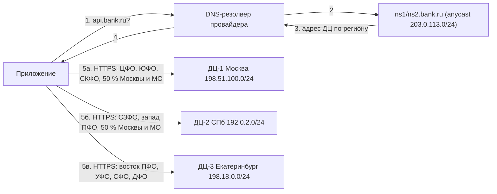
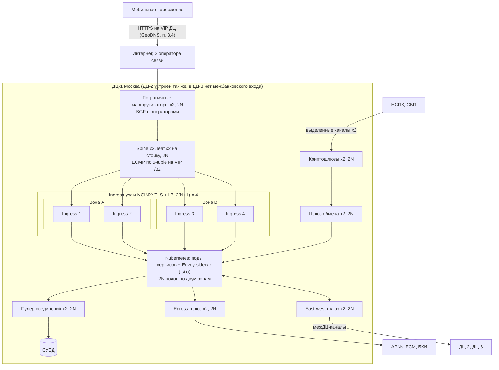
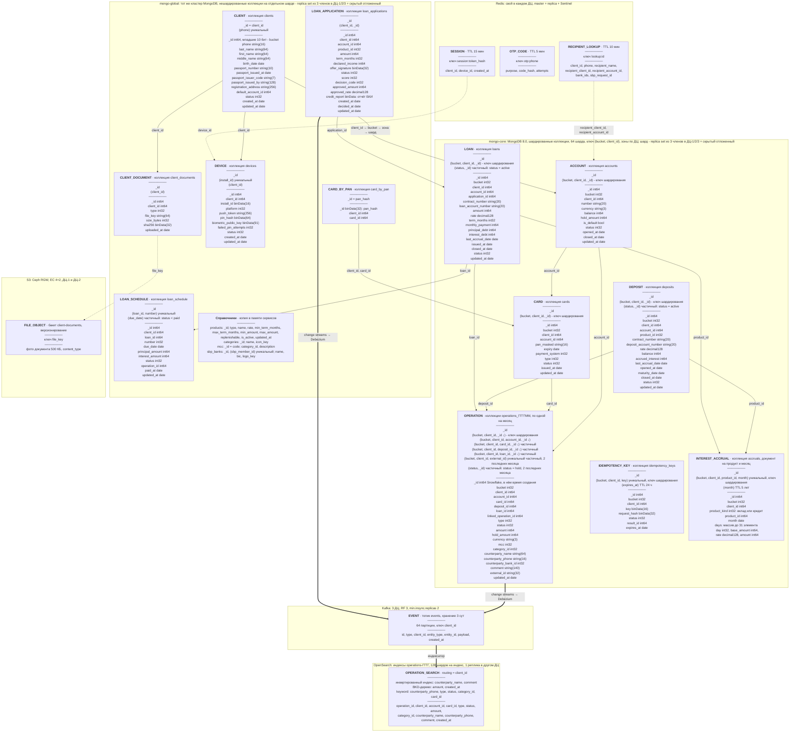

# Расчётно-пояснительная записка для курсовой работы по предмету "Проектирование высоконагруженных систем"

## 1. Тема и целевая аудитория

### Тип сервиса

Цифровой банк без отделений, по образцу Т-Банка. Аналоги в России: Озон Банк, Яндекс Банк. В мире: Revolut, Nubank, Monzo, Chime.

### Ключевой функционал (MVP)

- Регистрация и вход (по номеру телефона, подтверждение кодом, затем вход по PIN-коду или Face ID)
- Счета и карты (баланс, лента операций с дозагрузкой, поиск и фильтры по истории)
- Переводы по номеру телефона (внутри банка и через СБП)
- Вклады (открытие, пополнение, начисление процентов, закрытие)
- Кредиты (заявка, оценка кредитоспособности, выдача на счёт, график платежей и списание по графику)
- Push-уведомления по каждой операции

### Ключевые продуктовые решения

- Отделений нет, поэтому недоступность API равна недоступности банка
- Баланс считает только сервер, клиент его не кэширует и не пересчитывает
- Списание в два шага: удержание при покупке и списание по подтверждению от магазина
- Получатель перевода определяется по телефону через запрос в СБП прямо в момент операции
- Проценты по вкладам и кредитам начисляются раз в сутки, не в реальном времени. Ежемесячные платежи по кредитам списываются ночью
- Кредитный скоринг асинхронный: клиент подаёт заявку, решение приходит позже push-уведомлением

### Целевая аудитория

Россия, 34 млн MAU, 15,4 млн DAU (II кв. 2026, [[1]](https://cdn.tbank.ru/static/documents/724f5d58-cb93-443b-a7eb-72da6d42fe74.pdf)). Клиентская база банка 54,9 млн [[2]](https://cdn.tbank.ru/static/documents/afa4c849-6d6f-4b5c-bb22-b03f471fe18b.pdf). Аудитория распределена по 11 часовым поясам, но около 80 % населения живёт в зонах UTC+3 - UTC+5.

## 2. Расчёт нагрузки

### 2.1. Входные данные

| Параметр | Значение | Источник / обоснование |
| --- | --- | --- |
| Клиентская база | 54,9 млн | [[2]](https://cdn.tbank.ru/static/documents/afa4c849-6d6f-4b5c-bb22-b03f471fe18b.pdf) |
| Месячная аудитория (MAU) | 34 млн | [[1]](https://cdn.tbank.ru/static/documents/724f5d58-cb93-443b-a7eb-72da6d42fe74.pdf) |
| Дневная аудитория (DAU) | 15,4 млн | [[1]](https://cdn.tbank.ru/static/documents/724f5d58-cb93-443b-a7eb-72da6d42fe74.pdf) |
| Доля банка на розничном рынке | 1/6 (16,7 %) | по итогам 2025 года на клиентов группы пришёлся каждый шестой рубль розничного оборота страны, объём покупок 9,8 трлн руб. [[11]](https://t-technologies.ru/results/) |
| Безналичных платежей за товары и услуги в сутки по РФ | 243 млн | [[4]](https://cbr.ru/press/event/?id=28123) |
| Переводов между физлицами через СБП в сутки по РФ | 36 млн | 3,2 млрд за квартал / 90 дней [[3]](https://www.cbr.ru/Collection/Collection/File/61008/development_nps_2026-q1.pdf) |
| Платёжных карт в РФ | 544,8 млн | на 1 января 2026 года [[12]](https://www.cbr.ru/statistics/nps/psrf/) |
| Карт на клиента | 1,65 | 544,8 млн карт x 1/6 = 91 млн карт банка, на 54,9 млн клиентов это 1,65 карты. Карта выпускается к счёту, данные счёта хранятся в той же записи |
| Доля переводов внутри банка | 40 % | допущение: клиенты банка составляют 47 % взрослых (54,9 / 116 млн [[7]](https://rosstat.gov.ru/folder/12781)), но перевод идёт на основной счёт получателя, а основным наш банк является не для всех |
| Заходов в приложение в сутки | 1-2 раза 36 %, 3-5 раз 18 %, более 5 раз 11 %, реже чем ежедневно 35 % | [[8]](https://www.rshb.ru/news/05062026-000001) |
| Действующих вкладов | 5,8 млн | вклад есть у трети взрослых [[9]](https://wciom.ru/analytical-reviews/analiticheskii-obzor/banki-i-vklady-monitoring), около 35 млн человек; при доле банка 1/6 это 35 x 1/6 = 5,8 млн |
| Действующих кредитов | 7,1 млн | заёмщиков в банках 42,5 млн (48,5 млн всего за вычетом 6,0 млн заёмщиков только МФО) [[10]](https://cbr.ru/Collection/Collection/File/60963/inf-material_bki_2025sh.pdf); при доле банка 1/6 это 42,5 x 1/6 = 7,1 млн |
| Средний срок вклада / кредита | 6 месяцев / 3 года | по структуре вкладов и кредитов по срочности [[14]](https://www.cbr.ru/statistics/bank_sector/int_rat/) |
| Доля одобренных кредитных заявок | 25 % | НБКИ, май 2026: одобряется 24,7 % заявок по розничным кредитам [[15]](https://www.nbki.ru/company/news/) |
| Новых клиентов в год | 4,9 млн (8,9 % базы) | прирост: 41,9 млн (I кв. 2024) → более 50 млн (I кв. 2025) [[13]](https://www.tbank.ru/about/news/22052025-t-technologies-announces-financial-results-under-ifrs-for-q1-2025/) → 54,9 млн (I кв. 2026) [[2]](https://cdn.tbank.ru/static/documents/afa4c849-6d6f-4b5c-bb22-b03f471fe18b.pdf). Рост замедляется (+8,1 млн, затем +4,9 млн), берём последний год. Это чистый прирост с учётом оттока |
| Срок хранения финансовых данных | 5 лет | [[5]](https://www.consultant.ru/document/cons_doc_LAW_32834/), [[6]](https://www.consultant.ru/document/cons_doc_LAW_122855/) |
| Размер записи операции | 1 КБ | 500 Б данных (идентификаторы, суммы, валюта, категория, статус, метки времени) + 500 Б индексов |
| Размер операции по начислению процентов | 200 Б | счёт, дата, ставка, сумма |
| Фото документов на клиента | 3 шт. по 500 КБ | удалённая идентификация по 115-ФЗ: разворот паспорта, страница с регистрацией, селфи. Снимок с камеры телефона (3-5 МБ) сжимается до 500 КБ, этого достаточно для OCR и визуальной проверки |
| Коэффициент внутрисуточного пика | 3 | см. ниже |

Коэффициент пика принят равным 3, то есть на час пик приходится 12,5 % суточного объёма против 4,2 % при равномерной нагрузке. Аудитория распределена по 11 часовым поясам, но около 80 % населения живёт в зонах UTC+3 - UTC+5, поэтому вечерние пики этих зон почти совпадают и сглаживание слабое. Нагрузка банка привязана к бытовому ритму: покупки по дороге с работы и вечерние переводы концентрируются в 18:00-21:00 МСК. Значение взято с запасом на дни массовых выплат и распродаж.

### 2.2. Продуктовые метрики

Платежи считаем через долю банка на рынке: 243 млн платежей в сутки x 1/6 = 40,5 млн платежей в сутки, или 40,5 / 15,4 = 2,63 на DAU. Доля известна по объёму в рублях, а применяется к количеству: допускаем, что средний чек клиентов банка близок к среднему по рынку. Каждый платёж - две операции: удержание суммы при покупке и списание после подтверждения магазина; в ленте операций это одна запись.

Переводы считаем так же: 36 млн переводов в СБП x 1/6 = 6 млн исходящих в СБП в сутки. Ещё 40 % переводов не выходят за пределы банка, поэтому всего исходящих 6 / 0,6 = 10 млн в сутки, или 10 / 15,4 = 0,65 на DAU. Входящих столько же: обмен с другими банками сбалансирован. Перед каждым исходящим переводом получатель определяется запросом в СБП, поэтому таких запросов тоже 0,65 на DAU.

Сессий на пользователя в сутки считаем по опросу [[8]](https://www.rshb.ru/news/05062026-000001). Ежедневно заходят в банковское приложение 65 % респондентов: 36 % - 1-2 раза в день, 18 % - 3-5 раз, 11 % - более пяти раз. DAU - это пользователи, зашедшие в приложение сегодня, поэтому нормируем доли на ежедневных пользователей: 36 / 65 = 0,55; 18 / 65 = 0,28; 11 / 65 = 0,17. Для интервалов берём середины (1,5 для "1-2" и 4 для "3-5"), для открытого интервала "более 5" принимаем 6. Получаем 0,55 x 1,5 + 0,28 x 4 + 0,17 x 6 = 3 сессии в сутки, всего 3 x 15,4 = 46,2 млн сессий в сутки.

За одну сессию пользователь выполняет один вход и один запрос баланса: по продуктовому решению баланс считает только сервер, поэтому он запрашивается при каждом открытии приложения. Там же загружается первая страница ленты операций - один запрос на сессию; дозагрузка отдельно не учитывается из-за отсутствия данных. График платежей заёмщик смотрит раз в месяц перед платежом: 7,1 млн кредитов / 30 = 236 тыс. запросов в сутки, или 0,015 на DAU. Поиск по истории принимаем равным одному разу в неделю на DAU (1/7 = 0,14 в сутки) - это допущение, статистики по нему нет.

Операции по вкладам и кредитам считаются от числа продуктов. Число открытий и выдач получается из размера портфеля, среднего срока и темпа роста базы (8,9 % в год, п. 2.1): в год закрывается портфель / срок, а открывается столько же плюс прирост.

- закрытие вклада: 5,8 млн вкладов при среднем сроке 6 месяцев → 5,8 / 0,5 = 11,7 млн в год, или 32 тыс. в сутки. Пролонгации в MVP нет, поэтому окончание срока считается закрытием, а продление - новым открытием;
- открытие вклада: закрытия плюс прирост 8,9 % x 5,8 млн = 0,5 млн в год → 12,2 млн в год, или 33 тыс. в сутки;
- пополнение вклада: одно в месяц на вклад → 5,8 млн / 30 = 194 тыс. в сутки. Это допущение: статистики по частоте пополнений нет, частота привязана к зарплатному циклу;
- выдача кредита: 7,1 млн кредитов при среднем сроке 3 года → погашается 2,4 млн в год, с приростом 8,9 % выдаётся 3,0 млн в год, или 8,2 тыс. в сутки;
- заявка на кредит: одобряется 25 % заявок → 8,2 / 0,25 = 33 тыс. в сутки; скоринг выполняется по каждой заявке.

Фоновые операции MVP на DAU не делятся и считаются отдельно:

- начисление процентов: по каждому вкладу и кредиту раз в сутки, 5,8 + 7,1 = 12,9 млн проводок в ночное окно 03:00-05:00 МСК;
- списание по графику: 7,1 млн кредитов / 30 дней = 236 тыс. в сутки, в том же ночном окне.

Push-уведомление отправляется по каждой клиентской финансовой операции (платёж, перевод, операция по вкладу, выдача кредита, списание по графику) и по решению по кредитной заявке. Ежесуточное начисление процентов уведомлений не порождает.

#### 2.2.1. Сводные продуктовые метрики

| Метрика | Значение | Источник / расчёт |
| --- | --- | --- |
| Зарегистрированных клиентов | 54,9 млн | [[2]](https://cdn.tbank.ru/static/documents/afa4c849-6d6f-4b5c-bb22-b03f471fe18b.pdf) |
| Месячная аудитория | 34 млн | [[1]](https://cdn.tbank.ru/static/documents/724f5d58-cb93-443b-a7eb-72da6d42fe74.pdf) |
| Суточная аудитория | 15,4 млн | [[1]](https://cdn.tbank.ru/static/documents/724f5d58-cb93-443b-a7eb-72da6d42fe74.pdf) |
| DAU / MAU | 45 % | расчёт |
| Сессий в сутки | 46,2 млн | 3 x 15,4 млн |
| Действий пользователя в сутки | 20,3 на DAU | разбивка по типам в табл. 2.2.2 |
| Средний объём хранения на клиента | 3,6 МБ (0,0036 ГБ) | разбивка по типам в табл. 2.2.3 |
| Клиентских финансовых операций в сутки | 61,0 млн | 40,5 платежей + 10,0 исходящих + 10,0 входящих переводов + 0,5 по вкладам и кредитам |
| Push-уведомлений в сутки | 61,0 млн | по одному на финансовую операцию и решение по заявке |
| Запросов к серверу в сутки | 327 млн | все операции табл. 2.2.2, включая фоновые |
| Новых клиентов в сутки | 13,4 тыс. | 4,9 млн / 365 |
| Выпущенных карт | 91 млн | 1,65 x 54,9 млн |
| Действующих вкладов / кредитов | 5,8 млн / 7,1 млн | п. 2.1 |

#### 2.2.2. Среднее количество действий пользователя по типам в сутки

Типы операций соответствуют функциям MVP из п. 1.

| Функция MVP | Операция | На DAU в сутки | Расчёт |
| --- | --- | --- | --- |
| Регистрация и вход | Регистрация | 0,0009 | 13,4 тыс. / 15,4 млн |
| | Вход (PIN / Face ID) | 3,0 | 1 x 3 сессии |
| Счета и карты | Получение баланса и списка карт | 3,0 | 1 x 3 |
| | Страница ленты операций | 3,0 | 1 x 3 |
| | Поиск и фильтры по истории | 0,14 | 1 раз в неделю |
| | Платёж: удержание | 2,63 | 40,5 млн / 15,4 млн |
| | Платёж: списание | 2,63 | 1:1 к удержаниям |
| Переводы | Определение получателя в СБП | 0,65 | 1:1 к исходящим переводам |
| | Исходящий перевод | 0,65 | 10,0 млн / 15,4 млн |
| | Входящий перевод | 0,65 | равно исходящим |
| Вклады | Открытие вклада | 0,0022 | 33 тыс. / 15,4 млн |
| | Пополнение вклада | 0,013 | 194 тыс. / 15,4 млн |
| | Закрытие вклада | 0,0021 | 32 тыс. / 15,4 млн |
| Кредиты | Заявка на кредит | 0,0021 | 33 тыс. / 15,4 млн |
| | Скоринг заявки | 0,0021 | 1:1 к заявкам |
| | Выдача кредита на счёт | 0,0005 | 8,2 тыс. / 15,4 млн |
| | Получение графика платежей | 0,015 | 236 тыс. / 15,4 млн |
| Push-уведомления | Отправка уведомления | 3,96 | 61,0 млн / 15,4 млн |
| **Итого** | | **20,3** | 313 млн операций в сутки |
| Вклады и кредиты (фон) | Начисление процентов | - | 12,9 млн проводок в сутки |
| Кредиты (фон) | Списание по графику | - | 236 тыс. в сутки |

#### 2.2.3. Средний объём хранения на одного клиента

Расчёт ведётся на всю клиентскую базу 54,9 млн: данные хранятся и для тех, кто сегодня не заходил в приложение. Количество записей на клиента - общий объём соответствующего типа (п. 2.3.1), делённый на размер базы.

| Тип данных | Штук на клиента | Размер единицы | Объём |
| --- | --- | --- | --- |
| Операции в ленте за 5 лет | 2 030 | 1 КБ | 2,03 МБ |
| Фото и сканы документов | 3 | 500 КБ | 1,50 МБ |
| Операции по начислению процентов за 5 лет | 429 | 200 Б | 0,09 МБ |
| Профиль, карты, договоры | 2,9 | 2-4 КБ | 0,01 МБ |
| **Итого** | | | **3,6 МБ (0,0036 ГБ)** |

Существенны два типа: лента операций и фото документов, вместе 97 % объёма.

### 2.3. Технические метрики

#### 2.3.1. Размер хранилища по типам данных

Записи в ленте: 61,0 млн клиентских финансовых операций в сутки. Списание обновляет запись удержания и новой записи не создаёт. Операции по начислению процентов: 12,9 млн в сутки, хранятся отдельным реестром.

| Тип данных | Количество, шт. | Расчёт | Объём, ТБ |
| --- | --- | --- | --- |
| Операции в ленте (5 лет) | 111 млрд | 61,0 млн x 1 825 x 1 КБ | 111 |
| Фото и сканы документов | 165 млн | 54,9 млн x 3 x 500 КБ | 82 |
| Реестр начислений (5 лет) | 23,6 млрд | 12,9 млн x 1 825 x 200 Б | 4,7 |
| Профили, карты, договоры | 158 млн | 54,9 млн x 4 КБ + 91 млн x 2 КБ + 12,9 млн x 4 КБ | 0,45 |
| **Итого (логический объём)** | | | **199** |
| **С трёхкратной репликацией** | | | **597** |

Годовой прирост около 31 ТБ: лента 22,3, начисления 0,9, документы новых клиентов 7,4 (4,9 млн x 1,5 МБ).

#### 2.3.2. RPS по типам запросов

Средний RPS = число операций в сутки / 86 400, пиковый = средний x 3.

| Операция | Средний RPS | Пиковый RPS |
| --- | --- | --- |
| Отправка push-уведомления | 706 | 2 119 |
| Вход (PIN / Face ID) | 535 | 1 604 |
| Получение баланса и списка карт | 535 | 1 604 |
| Страница ленты операций | 535 | 1 604 |
| Платёж: удержание | 469 | 1 406 |
| Платёж: списание | 469 | 1 406 |
| Определение получателя в СБП | 116 | 347 |
| Исходящий перевод | 116 | 347 |
| Входящий перевод | 116 | 347 |
| Поиск и фильтры по истории | 25 | 76 |
| Получение графика платежей | 2,7 | 8,2 |
| Пополнение вклада | 2,3 | 6,8 |
| Открытие вклада | 0,39 | 1,2 |
| Заявка на кредит | 0,38 | 1,1 |
| Скоринг заявки | 0,38 | 1,1 |
| Закрытие вклада | 0,37 | 1,1 |
| Регистрация | 0,16 | 0,47 |
| Выдача кредита на счёт | 0,09 | 0,28 |
| **Итого** | **3 628** | **10 883** |

Фоновые операции выполняются в ночном окне, поэтому их пик считается не через коэффициент, а по длительности окна (2 часа), и с дневным пиком не складывается:

| Фоновая операция | Средний RPS | Пиковый RPS |
| --- | --- | --- |
| Начисление процентов | 150 | 1 794 (12,9 млн за 7 200 с) |
| Списание по графику | 2,7 | 33 (236 тыс. за 7 200 с) |

Распределение дневной нагрузки: клиентский API 1 867 / 5 602 RPS, межсистемный обмен с НСПК, СБП и БКИ (удержания, списания, входящие переводы, скоринг, выдача) 1 054 / 3 161, отправка push в APNs/FCM 706 / 2 119.

Пик записи в основную БД днём: платежные операции и переводы, 1 406 + 1 406 + 347 + 347 = 3 507 оп/с. Ночное начисление процентов даёт 1 794 оп/с в часы минимальной пользовательской нагрузки.

#### 2.3.3. Сетевой трафик

Размеры сообщений по составу функций MVP. Страница ленты и результат поиска: 20 операций по 500 Б данных, 10 КБ. Баланс и список карт: 3 КБ. График платежей: 3 КБ. Ответ на вход, перевод, определение получателя, операции по вкладам и кредитам, регистрацию: 1 КБ. Сообщения обмена с НСПК и СБП: 0,5 КБ. Push: 1 КБ. Запрос клиента: 0,5 КБ. Кредитный отчёт из БКИ: 10 КБ. Фото документов при регистрации: 1,5 МБ. Средний трафик = суточный объём x 8 / 86 400, пиковый = средний x 3.

Статика приложения (иконки, логотипы) раздаётся через CDN и через сетевые интерфейсы банка не проходит; обновления приложения распространяются через магазины приложений. Оба типа в расчёт не входят.

**Исходящий трафик**

| Тип трафика | Средний, Гбит/с | Пиковый, Гбит/с | Суточный, ГБайт |
| --- | --- | --- | --- |
| Лента операций и поиск | 0,045 | 0,134 | 484 |
| Баланс и список карт | 0,013 | 0,038 | 139 |
| Push в APNs / FCM | 0,006 | 0,017 | 61 |
| Вход | 0,004 | 0,013 | 46 |
| Ответы в НСПК и СБП (платежные операции, входящие переводы) | 0,004 | 0,013 | 46 |
| Переводы (ответы клиенту и запросы в СБП) | 0,002 | 0,007 | 25 |
| График, вклады, кредиты, регистрация | 0,0001 | 0,0004 | 1 |
| **Итого** | **0,074** | **0,22** | **801** |

**Входящий трафик**

| Тип трафика | Средний, Гбит/с | Пиковый, Гбит/с | Суточный, ГБайт |
| --- | --- | --- | --- |
| Запросы клиентов к API | 0,0075 | 0,022 | 81 |
| Сообщения от НСПК, СБП и БКИ | 0,005 | 0,016 | 56 |
| Фото документов при регистрации | 0,002 | 0,006 | 20 |
| **Итого** | **0,015** | **0,044** | **157** |

## 3. Глобальная балансировка нагрузки

### 3.1. Функциональное разбиение по доменам

| Домен | Назначение | Балансировка |
| --- | --- | --- |
| api.bank.ru | клиентский API: вход, баланс, лента, платежи, переводы, вклады, кредиты | GeoDNS между ДЦ |
| api-msk.bank.ru, api-spb.bank.ru, api-ekb.bank.ru | прямые адреса ДЦ, зашиты в приложение для переключения при отказе | нет |
| ns1.bank.ru, ns2.bank.ru | авторитативные DNS-серверы | Anycast |
| - | обмен с НСПК, СБП, БКИ | выделенные каналы в ДЦ-1 и ДЦ-2, вне публичной балансировки |
| - | отправка push в APNs / FCM | исходящий трафик, балансировка не нужна |

Статика раздаётся через CDN и в расчёт не входит (п. 2.3.3).

### 3.2. Расположение ДЦ

| № | Расположение | Описание |
| --- | --- | --- |
| 1 | Москва | Здесь самое большое скопление клиентов: Москва и МО дают 21,8 млн человек, 15 % населения. Центры обработки НСПК и СБП находятся в Москве и области, поэтому платежные операции и переводы идут по самому короткому пути |
| 2 | Санкт-Петербург | Второй крупный узел связи. RTT до Москвы около 9 мс, поэтому возможна синхронная репликация. При этом города находятся в 650 км друг от друга и в разных энергосистемах, так что региональная авария не заденет оба ДЦ |
| 3 | Екатеринбург | Обслуживает Урал, Сибирь и Дальний Восток. Это самая восточная точка, где RTT до Москвы (около 23 мс) ещё позволяет синхронную репликацию. Новосибирск ближе к Сибири, но RTT до Москвы там около 45 мс, и каждая запись операции стала бы вдвое дольше |

Влияние на продуктовые метрики:
- Около 80 % пользователей (европейская часть и Урал) получают RTT до своего ДЦ не больше 25 мс.
- Дальний Восток (5 % населения) получает 80-100 мс. Пользователь этого не заметит, поскольку время ответа определяется обработкой операции и обменом с НСПК.
- Отказ любого одного ДЦ не останавливает банк (п. 3.3).

Почему три ДЦ:
- Один ДЦ исключён. Физических отделений нет, и отказ единственного ДЦ означает полную недоступность банка
- При двух ДЦ каждый должен уметь держать 100 % нагрузки, то есть запас x2. Кроме того, из двух площадок нельзя собрать кворум для синхронной репликации.
- При трёх ДЦ каждый рассчитан на 53 % нагрузки на случай отказа соседнего (запас около x1,5). Кворум "2 из 3" переживает потерю одного ДЦ, и каждая из _трёх_ реплик (п. 2.3.1) хранится в своём ДЦ.
- Больше трёх ДЦ не нужно. Кворум из N ДЦ переживает ⌊(N−1)/2⌋ отказов, поэтому чётное число ДЦ не добавляет отказоустойчивости. Например, 4 ДЦ, как и 3, переживают один отказ, при этом каналов между ДЦ становится вдвое больше (6 vs 3). 4 ДЦ экономят лишь 17 % мощностей (133 % против 150 %). 5 ДЦ переживают два отказа, но требуют 167 % мощностей, то есть дороже трёх. Защита от одновременного отказа двух ДЦ не окупается: ДЦ стоят в разных городах с независимым электропитанием и каналами связи, поэтому одновременный отказ двух из них крайне маловероятен.

### 3.3. Распределение нагрузки по ДЦ

Нагрузка распределяется пропорционально населению обслуживаемых регионов [[7]](https://rosstat.gov.ru/folder/12781). Клиенты банка есть во всех регионах. Москва и МО делятся между ДЦ-1 и ДЦ-2 поровну, иначе на ДЦ-1 пришлось бы 43 % нагрузки.

| ДЦ | Регионы | Население, млн | Доля | Средний RPS | Пиковый RPS |
| --- | --- | --- | --- | --- | --- |
| ДЦ-1 Москва | 50% Москвы и МО, остальной ЦФО, ЮФО, СКФО | 52,3 | 35,8 % | 1 299 | 3 896 |
| ДЦ-2 Санкт-Петербург | СЗФО, северо-запад ЦФО (Тверская, Ярославская, Ивановская, Костромская обл.), 50% Москвы и МО, запад ПФО | 47,2 | 32,3 % | 1 172 | 3 515 |
| ДЦ-3 Екатеринбург | восток ПФО (Башкортостан, Удмуртия, Пермский край, Оренбургская обл.), УФО, СФО, ДФО | 46,6 | 31,9 % | 1 157 | 3 472 |
| **Итого** | | **146,1** | **100 %** | **3 628** | **10 883** |

Каждый тип запросов из табл. 2.3.2 распределяется между ДЦ в тех же долях, поскольку ДЦ выбирается по региону клиента, а не по типу операции. Межбанковские запросы приходят по каналам НСПК в ДЦ-1 и ДЦ-2 и передаются в ДЦ клиента по межДЦ-каналам

Пиковые значения взяты с запасом: у Сибири и Дальнего Востока вечерний пик сдвинут на 2-7 часов, поэтому реальный пик ДЦ-3 ниже.

При отказе ДЦ его регионы делятся между оставшимися двумя так, чтобы нагрузка была близка к 50/50:

| Отказавший ДЦ | Куда уходят регионы | Нагрузка на оставшиеся |
| --- | --- | --- |
| ДЦ-1 | 50% Москвы и МО, ЦФО → ДЦ-2; ЮФО, СКФО → ДЦ-3 | ДЦ-2 49,8 %, ДЦ-3 50,2 % |
| ДЦ-2 | 50% Москвы и МО, СЗФО → ДЦ-1; северо-запад ЦФО, запад ПФО → ДЦ-3 | ДЦ-1 52,7 %, ДЦ-3 47,3 % |
| ДЦ-3 | восток ПФО, УФО → ДЦ-1; СФО, ДФО → ДЦ-2 | ДЦ-1 50,9 %, ДЦ-2 49,1 % |

Каждый ДЦ рассчитывается на 53 % суммарного пика: 10 883 x 0,53 ≈ 5 800 RPS.

### 3.4. DNS-балансировка

- GeoDNS определяет регион по IP резолвера или по подсети клиента из EDNS Client Subnet и отдаёт адрес ДЦ по таблице п. 3.3. Для Москвы и МО отдаются адреса ДЦ-1 и ДЦ-2 с весами 50/50.
- TTL записи 60 с.
- DNS-серверы проверяют доступность ДЦ каждые 5 с. Неисправный ДЦ убирается из ответов, его регионы перераспределяются по таблице отказов.

### 3.5. Anycast-балансировка

| Подсеть | Тип | Где анонсируется | Что на ней |
| --- | --- | --- | --- |
| 203.0.113.0/24 | anycast | все три ДЦ | авторитативный DNS ns1, ns2 |
| 198.51.100.0/24 | unicast | ДЦ-1 Москва | api-msk, API для регионов ДЦ-1 |
| 192.0.2.0/24 | unicast | ДЦ-2 Санкт-Петербург | api-spb, API для регионов ДЦ-2 |
| 198.18.0.0/24 | unicast | ДЦ-3 Екатеринбург | api-ekb, API для регионов ДЦ-3 |

Адреса условные. Anycast-подсеть анонсируется по BGP из всех ДЦ, и провайдер доставляет DNS-запрос в ближайший. При отказе DNS в ДЦ анонс снимается, запросы быстро уходят в соседние ДЦ.

Клиентский API на anycast не переводится по трём причинам:
- Распределением при anycast управляет маршрутизация провайдеров, а не банк. Москву и МО (15 % населения в одной точке) нельзя поделить между ДЦ, и ДЦ-1 получил бы перекос.
- Смена BGP-маршрута рвёт TCP-соединение, в том числе посреди платежа.
- Главный плюс anycast, быстрое переключение, даёт само приложение (п. 3.6).

### 3.6. Регулировка трафика между ДЦ

- При штатном режиме работы перераспределение идёт через веса GeoDNS. Можно сдвинуть долю Москвы между ДЦ-1 и ДЦ-2 или перенести регион в другой ДЦ.
- При отказе ДЦ DNS по health-check убирает его из ответов. Приложение при ошибке соединения или таймауте сразу повторяет запрос на резервный адрес (api-msk / api-spb / api-ekb по таблице отказов), не дожидаясь истечения TTL. Повтор платежа безопасен благодаря "ключу идемпотентности".
- При плановых работах вес ДЦ снижается до 0. ДЦ отключается, когда трафик падает почти до нуля. Клиентов, у которых ответ DNS закэширован дольше TTL, переключает уже приложение.

## 4. Локальная балансировка нагрузки

### 4.1. Схема балансировки

ДЦ делится на две зоны: группы стоек с независимым питанием и своими парами leaf-коммутаторов. Зоны служат доменами отказа при размещении ingress-узлов и подов.

| Уровень | Технология | Назначение | На ДЦ | Резервирование |
| --- | --- | --- | --- | --- |
| Выбор ДЦ | GeoDNS (раздел 3) | приводит клиента на VIP ДЦ | - | N+1 по ДЦ: 3 ДЦ по 53 % |
| Вход в ДЦ | пограничные маршрутизаторы, 2 оператора связи | BGP с операторами | 2 | 2N |
| Маршрутизация (L3/L4) | spine-leaf фабрика, ECMP с resilient hashing | раскидывает TCP-соединения по ingress-узлам по хешу 5-tuple | 2 spine, 2 leaf на стойку | 2N |
| L7 и терминация TLS | NGINX Ingress Controller на выделенных узлах | TLS, авторизация, лимиты, маршрутизация по URL, выбор пода на каждый запрос | 4 | 2(N+1), N = 1 (п. 4.3) |
| Межсервисный L7 | Envoy-sidecar, Istio | mTLS, выбор экземпляра на каждый запрос, таймауты, повторы | в каждом поде | не требуется |
| Сервисы | поды Kubernetes | бизнес-логика, stateless | - | 2N по зонам |
| Межбанковский вход | выделенные каналы, криптошлюзы, шлюз обмена | постоянные соединения с НСПК и СБП | 2 + 2 в ДЦ-1 и ДЦ-2 | 2N и второй ДЦ |
| Выход в интернет | egress-шлюз Envoy | push в APNs/FCM, запросы в БКИ | 2 | 2N |
| СУБД | пулер соединений | мультиплексирует соединения сервисов к СУБД | 2 | 2N |

Выбранные схемы:
- **Входящие запросы:** ECMP → ingress NGINX → под сервиса. Ingress-узлы анонсируют VIP ДЦ по BGP (MetalLB), анонс есть только у узла, где ingress прошёл readiness-пробу. Под выбирается алгоритмом `random two least_conn`. POST повторяется на другом поде только при наличии ключа идемпотентности (п. 3.6).
- **Отдельного уровня L4 (LVS) нет.** Его роль выполняет ECMP фабрики: весь пик ДЦ обрабатывает один ingress-узел (п. 4.3), а роутингом можно балансировать на надёжные выделенные узлы. L4 с таблицей соединений (Maglev, DPVS) понадобится, если ingress-узлов станут десятки.
- **Межсервисные запросы:** Envoy-sidecar в каждом поде, список подов рассылает istiod по результатам readiness-проб. Экземпляр выбирается по least request (power of two choices): сначала своя зона, затем свой ДЦ, затем соседний. ClusterIP (kube-proxy) не подходит: он балансирует соединения, а HTTP/2 и gRPC держат одно соединение, и все запросы пода уходят в один под.
- **Межбанковские запросы:** соединения по выделенным каналам постоянные, сообщения между ними распределяет сама платёжная система. Шлюз обмена передаёт сообщение в ДЦ клиента через сервисную сеть.

### 4.2. Терминация TLS

- Внешний TLS терминируется на ingress-узлах, внутри ДЦ работает mTLS сервисной сети.
- Один VIP на ДЦ, внутри ДЦ ECMP, session tickets с общим ключом на ingress-узлах всех трёх ДЦ. Клиент возобновляет сессию без полного handshake на любом узле, в том числе после переключения ДЦ. Ключ меняется раз в сутки.
- TLS 1.3, для старых устройств TLS 1.2 с ECDHE. 0-RTT выключен: повтор раннего запроса мог бы провести платёж дважды.
- Сертификат ECDSA P-256 с запасным RSA-2048, в приложении certificate pinning.

### 4.3. Расчёт количества балансировщиков

Нагрузка на один ДЦ (53 % суммарного пика, п. 3.3): 2 969 RPS клиентского API, 850 новых сессий в секунду, 0,10 Гбит/с исходящего и 0,015 Гбит/с входящего трафика. Push и межбанковский обмен через ingress не проходят.

**Ограничитель 1: терминация TLS.** Дорогая часть TLS - установка сессии, поэтому считаем новые TLS-сессии в секунду.

| Режим | Новых TLS-сессий в секунду на ДЦ |
| --- | --- |
| Штатный: одно HTTP/2-соединение на сессию приложения | 850 |
| Худший: каждый запрос открывает новое соединение (массовое переподключение после отказа соседнего ДЦ, смена сети у клиентов) | 2 969 |

Расчёт ведётся по худшему режиму. Производительность терминации TLS при полном handshake на каждое соединение:

| Источник | ПО и TLS-библиотека | Процессор | Handshakes/с | На ядро |
| --- | --- | --- | --- | --- |
| [[18]](https://www.haproxy.com/blog/state-of-ssl-stacks), 2025 | HAProxy, OpenSSL 3.1-3.4 | 64 ядра Graviton4 | 42 500 | 664 |
| [[18]](https://www.haproxy.com/blog/state-of-ssl-stacks), 2025 | HAProxy, OpenSSL 3.0 (штатная в Ubuntu 22.04 и 24.04) | 64 ядра Graviton4 | 21 000 | 328 |
| [[18]](https://www.haproxy.com/blog/state-of-ssl-stacks), 2025 | HAProxy, AWS-LC | 64 ядра Graviton4 | 63 000 | 984 |
| [[17]](https://blog.nginx.org/blog/testing-performance-nginx-ingress-controller-kubernetes), 2019 | NGINX Ingress Controller, OpenSSL 1.1.0g, RSA-2048 | 16 ядер Xeon Platinum 8168 | 54 877 | 3 430 |
| [[16]](https://blog.nginx.org/blog/testing-the-performance-of-nginx-and-nginx-plus-web-servers), 2017 | nginx, OpenSSL 1.0.1f, RSA-2048 | 16 ядер Xeon E5-2699 v3 | 6 676 | 417 |

Основное значение взято из самого свежего измерения [[18]](https://www.haproxy.com/blog/state-of-ssl-stacks): текущие версии OpenSSL 3.x, 664 handshakes/с на ядро. Стоимость handshake определяется TLS-библиотекой, а nginx использует ту же OpenSSL, поэтому оценка к нему применима. По [[18]](https://www.haproxy.com/blog/state-of-ssl-stacks) OpenSSL 3.x отстаёт от 1.1.1 в основном из-за блокировок между потоками. Рабочие процессы nginx однопоточные, так что для nginx эта оценка скорее пессимистична.

- на handshakes: C_TLS = 2 969 / 664 = 4,5 ядра;
- на запросы в установленных соединениях: по [[17]](https://blog.nginx.org/blog/testing-performance-nginx-ingress-controller-kubernetes) 28 640 HTTPS-запросов/с на ядро при ответе 1 КБ, для ответа 10 КБ (страница ленты) по [[16]](https://blog.nginx.org/blog/testing-the-performance-of-nginx-and-nginx-plus-web-servers) в 0,58 раза меньше, 16 600 запросов/с. C_RPS = 2 969 / 16 600 = 0,18 ядра;
- запас 1,5 на журнал запросов, подзапросы авторизации и агенты узла, выключенные в бенчмарках: C = (4,5 + 0,18) x 1,5 ≈ 7 ядер.

Проверка на самой медленной библиотеке, OpenSSL 3.0 (328 на ядро): C = (2 969 / 328 + 0,18) x 1,5 ≈ 14 ядер. Это тоже укладывается в один узел.

**Ограничитель 2: сеть.** По [[17]](https://blog.nginx.org/blog/testing-performance-nginx-ingress-controller-kubernetes) ingress-контроллер пропускает 8,8 Гбит/с, упираясь в карту 10 GbE:

N_net = ⌈0,10 / 8,8⌉ = 1, загрузка 1,2 %

**Итог.** Узел: 16 физических ядер, 64 ГБ ОЗУ, 2 x 25 GbE. По [[16]](https://blog.nginx.org/blog/testing-the-performance-of-nginx-and-nginx-plus-web-servers) и [[17]](https://blog.nginx.org/blog/testing-performance-nginx-ingress-controller-kubernetes) до 16 ядер производительность растёт почти линейно. По [[18]](https://www.haproxy.com/blog/state-of-ssl-stacks) до 12-16 потоков все библиотеки идут вровень, расхождение начинается дальше.

N = max(⌈7 / 16⌉, ⌈0,10 / 8,8⌉) = 1

Весь пик ДЦ обрабатывает один узел, поэтому число узлов определяет надёжность:
- N+1 внутри зоны: один узел может быть на обновлении или в отказе;
- x2 по зонам: каждая зона в одиночку держит всю нагрузку ДЦ.

**Итого 2(N+1) = 4 ingress-узла на ДЦ, 12 на три ДЦ.** Схема 2N с двумя узлами оставляла бы ДЦ без резерва на время обновления узла.

| Состояние | Узлов в работе | Загрузка CPU узла в худшем режиме |
| --- | --- | --- |
| Штатно | 4 | 11 % |
| Отказ зоны | 2 | 22 % |
| Отказ зоны и узла в оставшейся зоне | 1 | 44 % |

### 4.4. Отказоустойчивость

| Отказ | Что происходит |
| --- | --- |
| Ingress-узел | BFD обнаруживает отказ за доли секунды, анонс VIP снимается, ECMP переводит соединения узла на остальные. Клиенты возобновляют TLS-сессию по тикету и повторяют запрос с тем же ключом идемпотентности |
| Зона ДЦ | трафик принимают ingress-узлы и поды второй зоны, их хватает на всю нагрузку (2N) |
| Маршрутизатор или оператор связи | трафик идёт через второй маршрутизатор и второго оператора |
| Под сервиса или его перегрузка | readiness-проба, пассивная проверка nginx и outlier detection Envoy убирают под из балансировки. Идемпотентный запрос повторяется на другом поде по таймауту, выбранному по квантилям |
| Все поды сервиса в ДЦ | Envoy отправляет запросы в соседний ДЦ через east-west-шлюз |
| ДЦ целиком | п. 3.6 |
## 5. Логическая схема БД

Схема построена от запросов MVP (п. 1, табл. 2.2.2): каждое поле нужно хотя бы одному запросу

### 5.1. Логическая схема

Основные данные, справочники, файлы, кеши, буферы и производные данные на одной схеме. Пунктиром показаны связи без внешнего ключа: событие ссылается на операцию или заявку через entity_type и entity_id, поисковый индекс - копия операции, код из SMS связан с клиентом только по номеру телефона.

```mermaid
erDiagram
    CLIENT ||--o{ DEVICE : "входит с"
    CLIENT ||--o{ CLIENT_DOCUMENT : "идентифицирован по"
    CLIENT ||--o{ ACCOUNT : "владеет"
    ACCOUNT ||--o{ CARD : "карта к счёту"
    ACCOUNT ||--o{ OPERATION : "движение по счёту"
    CARD |o--o{ OPERATION : "оплата картой"
    OPERATION |o--o| OPERATION : "вторая сторона перевода внутри банка"
    CATEGORY ||--o{ MCC : "группирует"
    CATEGORY ||--o{ OPERATION : "категория"
    SBP_BANK |o--o{ OPERATION : "банк контрагента"
    CLIENT ||--o{ DEPOSIT : "вкладчик"
    ACCOUNT ||--o{ DEPOSIT : "счёт пополнения и выплаты"
    PRODUCT ||--o{ DEPOSIT : "тариф"
    DEPOSIT |o--o{ OPERATION : "операции по вкладу"
    DEPOSIT |o--o{ INTEREST_ACCRUAL : "начисления"
    CLIENT ||--o{ LOAN_APPLICATION : "подал"
    ACCOUNT ||--o{ LOAN_APPLICATION : "счёт зачисления"
    PRODUCT ||--o{ LOAN_APPLICATION : "тариф"
    LOAN_APPLICATION ||--o| LOAN : "выдан по заявке"
    CLIENT ||--o{ LOAN : "заёмщик"
    ACCOUNT ||--o{ LOAN : "счёт выдачи и погашения"
    LOAN ||--|{ LOAN_SCHEDULE : "график"
    LOAN |o--o{ OPERATION : "операции по кредиту"
    LOAN |o--o{ INTEREST_ACCRUAL : "начисления"
    OPERATION |o--o| LOAN_SCHEDULE : "списание платежа"

    CLIENT_DOCUMENT ||--|| FILE_OBJECT : "фото документа"
    LOAN_APPLICATION |o--o| FILE_OBJECT : "отчёт БКИ"
    CLIENT ||--o{ SESSION : "сессия"
    DEVICE ||--o{ SESSION : "открыта с"
    CLIENT |o..o{ OTP_CODE : "по номеру телефона"
    CLIENT ||--o{ IDEMPOTENCY_KEY : "ключ повтора"
    CLIENT ||--o{ RECIPIENT_LOOKUP : "ищет получателя"
    ACCOUNT |o--o{ RECIPIENT_LOOKUP : "счёт получателя в банке"
    OPERATION |o..o{ EVENT : "изменение операции"
    LOAN_APPLICATION |o..o{ EVENT : "заявка и решение"
    OPERATION ||..|| OPERATION_SEARCH : "индексируется"

    CLIENT {
        int64 id PK
        varchar(16) phone UK "E.164"
        varchar(64) last_name
        varchar(64) first_name
        varchar(64) middle_name
        date birth_date
        char(10) passport_number "серия и номер"
        date passport_issued_at
        char(7) passport_issuer_code
        varchar(128) passport_issued_by
        varchar(256) registration_address
        enum status
        timestamp created_at
        timestamp updated_at
    }
    DEVICE {
        int64 id PK
        int64 client_id FK
        uuid install_id UK
        enum platform "iOS или Android"
        varchar(256) push_token
        bytes(64) pin_hash "Argon2id"
        bytes(91) biometric_public_key "для Face ID"
        int16 failed_pin_attempts
        enum status
        timestamp created_at
        timestamp updated_at
    }
    CLIENT_DOCUMENT {
        int64 id PK
        int64 client_id FK
        enum type "паспорт, регистрация, селфи"
        varchar(64) file_key FK "объект в FILE_OBJECT"
        int32 size_bytes
        bytes(32) sha256
        timestamp uploaded_at
    }
    ACCOUNT {
        int64 id PK
        int64 client_id FK
        char(20) number UK
        char(3) currency
        money balance
        money hold_amount "сумма активных удержаний"
        bool is_default "для входящих переводов"
        enum status
        timestamp opened_at
        timestamp closed_at
        timestamp updated_at
    }
    CARD {
        int64 id PK
        int64 account_id FK
        bytes(32) pan_hash UK "HMAC номера карты"
        char(16) pan_masked
        date expiry
        enum payment_system
        enum type "физическая или виртуальная"
        enum status
        timestamp issued_at
        timestamp updated_at
    }
    OPERATION {
        int64 id PK
        int64 account_id FK
        int64 card_id FK
        int64 deposit_id FK
        int64 loan_id FK
        int64 linked_operation_id FK
        enum type
        enum status "удержание, проведена, отменена, в обработке"
        money amount
        money hold_amount
        char(3) currency
        int16 mcc
        int16 category_id FK
        varchar(64) counterparty_name "снимок на момент операции"
        varchar(16) counterparty_phone
        int32 counterparty_bank_id FK
        varchar(140) comment
        varchar(32) external_id UK "RRN или ID операции СБП"
        timestamp created_at
        timestamp updated_at
    }
    DEPOSIT {
        int64 id PK
        int64 client_id FK
        int64 account_id FK
        int32 product_id FK
        varchar(20) contract_number UK
        char(20) deposit_account_number UK
        decimal rate
        money balance
        money accrued_interest
        timestamp opened_at
        date maturity_date
        timestamp closed_at
        timestamp updated_at
        enum status
    }
    LOAN {
        int64 id PK
        int64 client_id FK
        int64 account_id FK
        int64 application_id FK
        varchar(20) contract_number UK
        char(20) loan_account_number UK
        money amount
        decimal rate
        int16 term_months
        money monthly_payment
        money principal_debt
        money interest_debt
        timestamp issued_at
        timestamp closed_at
        timestamp updated_at
        enum status
    }
    LOAN_SCHEDULE {
        int64 loan_id PK, FK
        int16 number PK
        date due_date
        money principal_amount
        money interest_amount
        enum status "запланирован, оплачен, просрочен"
        int64 operation_id FK
        timestamp paid_at
        timestamp updated_at
    }
    LOAN_APPLICATION {
        int64 id PK
        int64 client_id FK
        int64 account_id FK
        int32 product_id FK
        money amount
        int16 term_months
        money declared_income
        bytes(32) offer_signature "подписанная оферта"
        enum status
        int16 score
        int16 decision_code
        money approved_amount
        decimal approved_rate
        varchar(64) credit_report_key FK "отчёт БКИ в FILE_OBJECT"
        timestamp created_at
        timestamp decided_at
        timestamp updated_at
    }
    INTEREST_ACCRUAL {
        int64 deposit_id FK "заполнено ровно одно из двух"
        int64 loan_id FK
        date accrual_date "уникальна вместе с продуктом"
        money base_amount
        decimal rate
        money amount
    }
    PRODUCT {
        int32 id PK
        enum type "вклад или кредит"
        varchar(64) name
        decimal rate
        int16 min_term_months
        int16 max_term_months
        money min_amount
        money max_amount
        bool replenishable
        bool is_active
        timestamp updated_at
    }
    CATEGORY {
        int16 id PK
        varchar(64) name
        varchar(64) icon_key
    }
    MCC {
        int16 code PK
        int16 category_id FK
        varchar(128) description
    }
    SBP_BANK {
        int32 id PK
        char(12) sbp_member_id UK
        varchar(64) name
        char(9) bic
        varchar(64) logo_key
    }
    FILE_OBJECT {
        varchar(64) key PK
        varchar(32) content_type
        blob content "фото 500 КБ, отчёт 10 КБ"
        timestamp created_at
    }
    SESSION {
        bytes(32) token_hash PK "TTL 15 мин"
        int64 client_id FK
        int64 device_id FK
        timestamp created_at
        timestamp expires_at
    }
    OTP_CODE {
        varchar(16) phone PK "TTL 5 мин"
        enum purpose "регистрация или новое устройство"
        bytes(32) code_hash
        int8 attempts
        timestamp expires_at
    }
    IDEMPOTENCY_KEY {
        int64 client_id PK, FK "TTL 24 ч"
        uuid key PK
        bytes(32) request_hash
        enum status
        int64 result_id "созданная операция, вклад, заявка"
        timestamp expires_at
    }
    RECIPIENT_LOOKUP {
        uuid id PK "TTL 10 мин"
        int64 client_id FK
        varchar(16) phone
        varchar(64) recipient_name
        int64 recipient_account_id FK "если получатель наш клиент"
        int32[] bank_ids "банки получателя в СБП"
        varchar(32) sbp_request_id
        timestamp expires_at
    }
    EVENT {
        uuid id PK "хранение 3 суток"
        enum type
        int64 client_id FK
        enum entity_type "операция или заявка"
        int64 entity_id
        json payload "снимок операции"
        timestamp created_at
    }
    OPERATION_SEARCH {
        int64 operation_id PK, FK
        int64 client_id FK
        int64 account_id
        int64 card_id
        enum type
        enum status
        money amount
        int16 category_id
        varchar(64) counterparty_name
        varchar(16) counterparty_phone
        varchar(140) comment
        timestamp created_at
    }
```

### 5.2. Описание таблиц

Размер строки - сумма полей без служебных данных СУБД и индексов. Хранение 5 лет: в таблицах договоров - действующие и закрытые за 5 лет. Для кешей и буферов строк - записей, живущих одновременно в пике.

| Таблица | Вид | Что хранит | Строк | Строка, Б | Объём |
| --- | --- | --- | --- | --- | --- |
| CLIENT | основные | клиенты: телефон, ФИО, паспорт | 54,9 млн - клиентская база | 642 | 35 ГБ |
| DEVICE | основные | привязанные устройства: PIN, ключ Face ID, push-токен | 54,9 млн - в среднем одно устройство на клиента | 463 | 25 ГБ |
| CLIENT_DOCUMENT | основные | описание фото документов | 165 млн = 54,9 млн x 3 | 125 | 21 ГБ |
| ACCOUNT | основные | текущие счета: остаток, удержания | 91 млн - по счёту на карту | 81 | 7,4 ГБ |
| CARD | основные | карты | 91 млн | 87 | 7,9 ГБ |
| OPERATION | основные | лента операций и выписка по счёту | 111 млрд = 61,0 млн x 1 825 сут | 345 | 38,4 ТБ |
| DEPOSIT | основные | вклады | 63,8 млн = 5,8 млн + 11,6 млн закрытий в год x 5 лет | 121 | 7,7 ГБ |
| LOAN | основные | кредиты | 18,9 млн = 7,1 млн + 2,37 млн погашений в год x 5 лет | 139 | 2,6 ГБ |
| LOAN_SCHEDULE | основные | график платежей | 682 млн = 18,9 млн x 36 | 55 | 37 ГБ |
| LOAN_APPLICATION | основные | заявки и решения скоринга | 59,9 млн = 32,8 тыс. x 1 825 сут | 187 | 11,2 ГБ |
| INTEREST_ACCRUAL | основные | подневные начисления процентов | 23,5 млрд = 12,9 млн x 1 825 сут | 44 | 1,04 ТБ |
| PRODUCT | справочник | тарифы вкладов и кредитов | ~100 | 107 | < 1 МБ |
| CATEGORY | справочник | категории операций | ~30 | 130 | < 1 МБ |
| MCC | справочник | коды MCC и их категории | ~1 000 | 132 | < 1 МБ |
| SBP_BANK | справочник | участники СБП | ~220 | 153 | < 1 МБ |
| FILE_OBJECT | файлы | фото документов, кредитные отчёты БКИ | 225 млн = 165 млн фото + 59,9 млн отчётов | 500 КБ / 10 КБ | 83,0 ТБ |
| SESSION | кеш, TTL 15 мин | сессии после входа | 1,45 млн = 1 608/с x 900 с | 64 | 93 МБ |
| OTP_CODE | кеш, TTL 5 мин | коды из SMS | 1,1 тыс. = 3,7/с x 300 с | 58 | < 1 МБ |
| IDEMPOTENCY_KEY | кеш, TTL 24 ч | ключи повторов клиентских запросов | 10,3 млн = 119/с x 86 400 с | 73 | 0,75 ГБ |
| RECIPIENT_LOOKUP | кеш, TTL 10 мин | результат определения получателя | 208 тыс. = 347/с x 600 с | 192 | 40 МБ |
| EVENT | буфер, хранение 3 сут | события по операциям и заявкам | 323 млн = 107,7 млн в сутки x 3 | 387 | 125 ГБ |
| OPERATION_SEARCH | производные | поисковый индекс по операциям | 111 млрд | 272 | 30,3 ТБ |
| **Итого** | | | | | **153 ТБ** |

### 5.3. Нагрузка на чтение и запись

Нагрузка из табл. 2.3.2, разложенная по таблицам. Пиковый QPS = средний x 3.

**Днём, QPS (средний / пиковый)**

| Таблица | Чтение | Запись |
| --- | --- | --- |
| CLIENT | 257 / 768 | 0,3 / 0,9 |
| DEVICE | 1 241 / 3 723 | 1,2 / 3,7 |
| CLIENT_DOCUMENT | 0,5 / 1,4 | 0,5 / 1,4 |
| ACCOUNT | 581 / 1 743 | 1 173 / 3 516 |
| CARD | 1 004 / 3 010 | 0,16 / 0,47 |
| OPERATION | 1 004 / 3 011 | 1 243 / 3 724 |
| DEPOSIT | 538 / 1 612 | 3,1 / 9,1 |
| LOAN | 538 / 1 612 | 0,09 / 0,28 |
| LOAN_SCHEDULE | 2,7 / 8,2 | 0,09 / 0,28 |
| LOAN_APPLICATION | 0,47 / 1,4 | 0,85 / 2,5 |
| INTEREST_ACCRUAL | - | - |
| FILE_OBJECT | 0,5 / 1,4 | 0,9 / 2,5 |
| **Итого основные таблицы** | **5 167 / 15 490** | **2 422 / 7 258** |
| Справочники | 1 658 / 4 970 | - |
| SESSION | 1 333 / 3 996 | 536 / 1 608 |
| OTP_CODE | 1,2 / 3,7 | 2,5 / 7,4 |
| IDEMPOTENCY_KEY | - | 119 / 357 |
| RECIPIENT_LOOKUP | 116 / 347 | 116 / 347 |
| EVENT | 2 486 / 7 449 | 1 244 / 3 726 |
| OPERATION_SEARCH | 25 / 76 | 1 243 / 3 724 |

**Ночное окно 03:00-05:00, пиковый QPS** (начисление процентов и списание по графику)

| Таблица | Чтение | Запись |
| --- | --- | --- |
| INTEREST_ACCRUAL | - | 1 794 |
| DEPOSIT | 807 | 807 |
| LOAN | 1 020 | 1 020 |
| LOAN_SCHEDULE | 33 | 33 |
| ACCOUNT, OPERATION, EVENT, OPERATION_SEARCH | - | по 33 |
| **Итого основные таблицы** | **1 860** | **3 720** |

### 5.4. Консистентность и распределение нагрузки по ключам

Почти все запросы адресованы одному клиенту: по client_id или по account_id и card_id, которые ему принадлежат. Клиентов 54,9 млн, поэтому по хешу клиента нагрузка распределяется ровно. Исключения - ключи CARD.pan_hash, OPERATION.external_id и CLIENT.phone, около 3 600 запросов в секунду в пике. По времени: дневной пик 18:00-21:00 МСК, фоновые задачи в окне 03:00-05:00.

| Таблица | Консистентность | Распределение нагрузки по ключам |
| --- | --- | --- |
| ACCOUNT | строгая: остаток и hold_amount меняются только в одной транзакции с OPERATION; баланс читается только актуальный | по client_id равномерно; горячий счёт - получатель массовых переводов, все зачисления в одну строку |
| OPERATION | строгая, атомарно с ACCOUNT; external_id уникален; лента - read-your-writes | (account_id, created_at): запись в конец истории, читаются в основном свежие записи, 5 лет истории почти холодные; id растут со временем, распределять по id или времени нельзя |
| Перевод внутри банка | списание у отправителя и зачисление получателю атомарно | счета отправителя и получателя - разные ключи |
| DEPOSIT, LOAN | строгая, вместе с ACCOUNT и OPERATION | по client_id на каждом запросе баланса, но у 87-89 % клиентов чтение пустое; ночью - проход по всем действующим |
| LOAN_SCHEDULE | строгая, вместе с LOAN и OPERATION | ночью выборка по due_date; распределять по due_date нельзя - платежи дня окажутся в одном месте |
| INTEREST_ACCRUAL | одно начисление на продукт в сутки, атомарно с accrued_interest или interest_debt | только запись, раз в сутки по всем продуктам |
| LOAN_APPLICATION | строгие переходы статусов, выдача ровно один раз | по client_id, нагрузка мала |
| CLIENT | запись строгая, phone уникален; имя получателя можно читать с реплики с отставанием до секунд | id; phone - 768/с, равномерно |
| DEVICE | строгая для status и счётчика ошибок PIN | id; client_id для push - равномерно |
| CARD | строгая для status | pan_hash - равномерный хеш, 1 406/с |
| CLIENT_DOCUMENT, FILE_OBJECT | неизменяемы после записи | client_id, key; нагрузка мала |
| Справочники | в конечном счёте, обновление за минуты | малы, около 5 000 чтений в секунду - копия в памяти сервисов |
| SESSION | строгая внутри ДЦ, между ДЦ не реплицируется | token_hash, равномерно; чтение на каждом запросе API |
| OTP_CODE | атомарный счётчик попыток | phone; нагрузка мала |
| IDEMPOTENCY_KEY | строгая, в одной транзакции с создаваемой записью | (client_id, key), равномерно |
| RECIPIENT_LOOKUP | read-after-write | id, равномерно |
| EVENT | доставка не реже одного раза, порядок внутри клиента | client_id - события клиента идут по порядку |
| OPERATION_SEARCH | в конечном счёте, отставание до секунд | client_id - поиск затрагивает данные одного клиента |

## 6. Физическая схема БД

Схема получена из логической (п. 5). У каждой таблицы выбрана СУБД, ключ шардирования и индексы под запросы из п. 5.2 (П.2). Таблицы основных данных хранятся как коллекции MongoDB. Размер документа - BSON: поля по максимальной длине, как в п. 5.2, плюс имена полей и служебные байты. На диске документы сжимаются (snappy), в оценке в 2 раза.

### 6.1. Схема

Сплошные стрелки - ссылки внутри MongoDB (внешних ключей в MongoDB нет, связь поддерживает приложение), пунктир - ссылки между разными хранилищами, жирные - потоки данных. В каждой коллекции сверху индексы, ниже поля.

### 6.2. Описание таблиц

| Таблица (коллекция) | БД | Шардирование | Партиции | Документов | Документ BSON / на диске, Б | Данные | Индексы | Всего |
| --- | --- | --- | --- | --- | --- | --- | --- | --- |
| OPERATION (operations_ГГГГММ) | mongo-core | (bucket, client_id), 64 шарда | коллекция на месяц, 60 | 111,3 млрд | 634 / 317 | 35,3 ТБ | 10,1 ТБ | 45,4 ТБ |
| INTEREST_ACCRUAL (accruals) | mongo-core | (bucket, client_id) | - | 774 млн: продукт x месяц | 2 454 / 1 227 | 950 ГБ | 52 ГБ | 1,0 ТБ |
| ACCOUNT (accounts) | mongo-core | (bucket, client_id) | - | 91 млн | 221 / 110 | 10,1 ГБ | 4,0 ГБ | 14,0 ГБ |
| DEPOSIT (deposits) | mongo-core | (bucket, client_id) | - | 63,8 млн | 361 / 180 | 11,5 ГБ | 2,9 ГБ | 14,4 ГБ |
| CARD (cards) | mongo-core | (bucket, client_id) | - | 91 млн | 199 / 100 | 9,1 ГБ | 4,0 ГБ | 13,0 ГБ |
| LOAN (loans) | mongo-core | (bucket, client_id) | - | 18,9 млн | 405 / 202 | 3,8 ГБ | 0,9 ГБ | 4,8 ГБ |
| IDEMPOTENCY_KEY (idempotency_keys) | mongo-core | (bucket, client_id) | - | 10,3 млн | 177 / 88 | 0,9 ГБ | 0,8 ГБ | 1,7 ГБ |
| **Итого mongo-core** | | | | | | **36,3 ТБ** | **10,2 ТБ** | **46,5 ТБ** |
| LOAN_APPLICATION (loan_applications) | mongo-global | нет | - | 59,9 млн | 343 / 172 + отчёт БКИ ~4 КБ | 250 ГБ | 3,1 ГБ | 253 ГБ |
| LOAN_SCHEDULE (loan_schedule) | mongo-global | нет | - | 682 млн | 206 / 103 | 70,2 ГБ | 26,4 ГБ | 96,7 ГБ |
| CLIENT (clients) | mongo-global | нет | - | 54,9 млн | 919 / 460 | 25,2 ГБ | 2,4 ГБ | 27,6 ГБ |
| CLIENT_DOCUMENT (client_documents) | mongo-global | нет | - | 164,7 млн | 208 / 104 | 17,1 ГБ | 5,1 ГБ | 22,3 ГБ |
| DEVICE (devices) | mongo-global | нет | - | 54,9 млн | 631 / 316 | 17,3 ГБ | 4,1 ГБ | 21,5 ГБ |
| CARD_BY_PAN (card_by_pan) | mongo-global | нет | - | 91 млн | 83 / 42 | 3,8 ГБ | 5,5 ГБ | 9,2 ГБ |
| PRODUCT, CATEGORY, MCC, SBP_BANK | mongo-global | нет | - | ~1 350 | 100-250 | < 1 МБ | < 1 МБ | < 1 МБ |
| **Итого mongo-global** | | | | | | **384 ГБ** | **47 ГБ** | **430 ГБ** |
| SESSION, OTP_CODE, RECIPIENT_LOOKUP | Redis | нет | - | 1,66 млн | 64-200 + ~90 на ключ | | | 0,3 ГБ на ДЦ |
| EVENT | Kafka | 64 партиции по client_id | - | 323 млн | 387 | | | 125 ГБ, с RF 3 - 375 ГБ |
| OPERATION_SEARCH | OpenSearch | 128 шардов на индекс, routing = client_id | индекс на год | 111,3 млрд | ~272 на диске | | | 30,3 ТБ, с репликой - 60,6 ТБ |
| FILE_OBJECT | S3 (Ceph RGW) | распределяет Ceph | - | 164,7 млн | 500 КБ | | | 82,4 ТБ, с EC и копией в ДЦ-2 - 247 ТБ |

### 6.3. Денормализация

Основной функционал выполняется без JOIN: каждый запрос - чтения по ключу в одном хранилище, а у денежных запросов - в одном шарде.

| Запрос | Пик, QPS | Как выполняется |
| --- | --- | --- |
| Проверка сессии | 3 996 | Redis: SESSION по token_hash |
| Вход | 1 604 | mongo-global, primary: devices по _id → Redis: SESSION |
| Баланс и список карт | 1 604 | шард клиента: accounts, cards, deposits, loans по (bucket, client_id) |
| Страница ленты | 1 604 | шард: operations текущего месяца по (bucket, client_id, _id < курсор), сортировка по _id ↓, 20 документов; если меньше - прошлый месяц. Категории и банки - из справочников в памяти сервиса |
| Операции по счёту, карте, вкладу, кредиту | входит в 76 | шард: operations по составному индексу продукта, месяцы от нового к старому |
| Платёж: удержание | 1 406 | mongo-global, ближайший член: card_by_pan по _id → шард, одна транзакция: cards и accounts по ключу, проверка external_id, вставка в operations, обновление accounts |
| Платёж: списание | 1 406 | card_by_pan → шард, транзакция: operations по (bucket, client_id, external_id), обновление operations и accounts |
| Определение получателя | 347 | mongo-global, ближайший член: clients по phone → Redis: RECIPIENT_LOOKUP |
| Исходящий перевод | 347 | Redis: RECIPIENT_LOOKUP → транзакция: idempotency_keys, accounts и operations отправителя и получателя; разные шарды - распределённая транзакция (п. 6.6) |
| Входящий перевод из СБП | 208 | clients по phone → шард получателя |
| Отправка push | 2 119 | Kafka: EVENT → mongo-global, ближайший член: devices по client_id |
| Поиск по истории | 76 | OpenSearch с routing = client_id |
| График платежей | 8,2 | loans по ключу → loan_schedule по (loan_id, number) |
| Начисление процентов (ночь) | 1 794 | в каждом шарде: deposits и loans по частичным индексам → транзакция: дописать день в документ accruals, обновить accrued_interest при last_accrual_date < сегодня |
| Списание по графику (ночь) | 33 | loan_schedule по частичному индексу (due_date) → транзакция с loans, accounts, operations |

Изменения относительно логической схемы:

| Изменение | Зачем | Почему копии не разойдутся |
| --- | --- | --- |
| client_id и bucket в operations, cards, accruals; bucket во всех шардированных коллекциях | данные клиента лежат в его шарде; bucket (младшие 10 бит client_id) - первое поле ключа шардирования, по нему заданы зоны; лента - один запрос без JOIN с accounts | владелец счёта, карты и кредита не меняется, bucket вычисляется из client_id |
| CARD_BY_PAN: pan_hash → client_id, card_id (pan_hash перенесён из cards) | НСПК присылает номер карты, а не клиента: по нему находится шард | документ неизменяем |
| clients.default_account_id - копия accounts.is_default | определение получателя и входящий перевод из СБП без похода в шард | обновляется событием из шарда за секунды; в худшем случае деньги придут на другой счёт того же клиента |
| RECIPIENT_LOOKUP.recipient_client_id | шард получателя для зачисления | живёт 10 мин |
| deposits.last_accrual_date, loans.last_accrual_date | повторный запуск ночной задачи не начислит дважды: условие в обновлении вместо уникального индекса на 23,5 млрд дневных записей | меняется в одной транзакции с accruals |
| Начисления: документ на продукт и месяц с массивом дней вместо записи на день | 774 млн документов вместо 23,5 млрд: 1 ТБ вместо 1,9 ТБ, индексы 52 ГБ | день дописывается в той же транзакции, что и accrued_interest |
| Отчёт БКИ - внутри документа заявки вместо FILE_OBJECT | 60 млн файлов по 10 КБ - проблема мелких файлов для объектного хранилища; читается вместе с заявкой | один документ |
| OPERATION без created_at | время в старших битах Snowflake _id: сортировка и курсор ленты по _id, коллекции по месяцам | - |

Без денормализации оставлено:
- справочники (~1 350 документов) не копируются в операции: они целиком в памяти сервисов;
- accounts, cards, deposits и loans не вкладываются в документ клиента: экран баланса читает их четырьмя короткими запросами в одном шарде, а платёж обновляет только документ счёта;
- имя контрагента, MCC и категория в operations - снимок на момент операции (п. 5), а не копия.

### 6.4. Индексы

Под каждый запрос к операциям - свой индекс. Все индексы шардированных коллекций начинаются с (bucket, client_id): запрос идёт в один шард, а индекс в нём локальный. Индекс по _id в MongoDB обязателен в каждой коллекции.

Размер = записей x байт на запись / заполнение страницы. Индекс WiredTiger - B-дерево:
- запись = ключ в формате KeyString (int64 и дата - около 9 Б, int32 - около 3 Б, строка - длина + 2 Б, binData - длина + 3 Б) + RecordId 8 Б + 2 Б служебных;
- префиксное сжатие индексов включено по умолчанию: общий с соседней записью префикс хранится один раз. В индексах, начинающихся с (bucket, client_id), соседние записи почти всегда одного клиента, поэтому эти 12 Б не повторяются;
- заполнение страниц - 90 %, если ключ растёт (_id, дата), и около 70 %, если вставка идёт в случайное место.

**mongo-core** (на 64 шарда; на шард - 1/64)

| Коллекция | Индекс | Тип | Для чего | Записей | Б (полная - общий префикс) / заполнение | Размер |
| --- | --- | --- | --- | --- | --- | --- |
| operations | _id | _id, уникальный | обязательный; операция по id | 111,3 млрд | (19 - 4) / 0,9 = 16,7 | 1,86 ТБ |
| operations | (bucket, client_id, _id ↓) | составной, ключ шардирования | лента, скоринг, операции клиента за период | 111,3 млрд | (31 - 12) / 0,7 = 27,1 | 3,02 ТБ |
| operations | (bucket, client_id, account_id, _id ↓) | составной | выписка по счёту | 111,3 млрд | (40 - 21) / 0,7 = 27,1 | 3,02 ТБ |
| operations | (bucket, client_id, card_id, _id ↓), где card_id есть | составной частичный | операции по карте | 73,9 млрд | 27,1 | 2,01 ТБ |
| operations | (bucket, client_id, deposit_id, _id ↓), где deposit_id есть | составной частичный | операции по вкладу | 473 млн | 27,1 | 12,8 ГБ |
| operations | (bucket, client_id, loan_id, _id ↓), где loan_id есть | составной частичный | операции по кредиту | 446 млн | 27,1 | 12,1 ГБ |
| operations | (bucket, client_id, external_id), где external_id есть; 2 последних месяца | уникальный частичный | списание находит удержание; повтор сообщения НСПК или СБП отклоняется | 3,2 млрд | (56 - 12) / 0,7 = 62,9 | 201 ГБ |
| operations | (status, _id), где status = hold; 2 последних месяца | частичный | отмена удержаний старше 30 дней | 81 млн | (22 - 7) / 0,9 = 16,7 | 1,4 ГБ |
| accruals | _id | _id, уникальный | обязательный | 774 млн | 16,7 | 12,9 ГБ |
| accruals | (bucket, client_id, product_id, month) | уникальный, ключ шардирования | дописать день в документ месяца; разбор начислений | 774 млн | (40 - 12) / 0,7 = 40 | 31 ГБ |
| accruals | (month) | TTL 5 лет | удаление старше 5 лет | 774 млн | (19 - 9) / 0,9 = 11,1 | 8,6 ГБ |
| accounts | _id; (bucket, client_id, _id) | _id; составной, ключ шардирования | баланс, удержание, перевод | 91 млн | 16,7; 27,1 | 4,0 ГБ |
| cards | _id; (bucket, client_id, _id) | _id; составной, ключ шардирования | список карт, удержание | 91 млн | 16,7; 27,1 | 4,0 ГБ |
| deposits | _id; (bucket, client_id, _id) | _id; составной, ключ шардирования | баланс, операции по вкладу | 63,8 млн | 16,7; 27,1 | 2,8 ГБ |
| deposits | (status, _id), где status = active | частичный | ночное начисление | 5,8 млн | 16,7 | 0,1 ГБ |
| loans | _id; (bucket, client_id, _id) | _id; составной, ключ шардирования | баланс, график | 18,9 млн | 16,7; 27,1 | 0,8 ГБ |
| loans | (status, _id), где status = active | частичный | ночное начисление | 7,1 млн | 16,7 | 0,1 ГБ |
| idempotency_keys | _id; (bucket, client_id, key) | _id; уникальный, ключ шардирования | проверка повтора запроса | 10,3 млн | 16,7; (41 - 12) / 0,7 = 41,4 | 0,6 ГБ |
| idempotency_keys | (expires_at) | TTL 24 ч | удаление ключей старше суток | 10,3 млн | 16,7 | 0,2 ГБ |
| **Итого** | | | | | | **10,2 ТБ, 159 ГБ на шард** |

- 99 % индексов mongo-core - индексы operations.
- Индексы по счёту и по карте разные: выписка по счёту включает переводы и операции по вкладам и кредитам, а операции по карте - только платежи картой.
- Уникальный индекс по external_id есть только в коллекциях текущего и прошлого месяца: списание приходит в течение 30 дней, повтор сообщения - в течение минут. На всех 60 месяцах он занял бы 6 ТБ. Перед вставкой транзакция дополнительно проверяет коллекцию прошлого месяца, поэтому повтор на границе месяцев не проходит.
- Дневные начисления хранятся массивом в документе месяца, поэтому индексов на 774 млн документов, а не на 23,5 млрд записей.

**mongo-global**

| Коллекция | Индекс | Тип | Для чего | Записей | Б | Размер |
| --- | --- | --- | --- | --- | --- | --- |
| clients | _id = client_id | _id, уникальный | профиль, скоринг | 54,9 млн | 16,7 | 0,9 ГБ |
| clients | (phone) | уникальный | регистрация, определение получателя, входящий из СБП | 54,9 млн | (24 - 5) / 0,7 = 27,1 | 1,5 ГБ |
| devices | _id | _id, уникальный | вход | 54,9 млн | 16,7 | 0,9 ГБ |
| devices | (install_id) | уникальный | привязка устройства | 54,9 млн | (29 - 3) / 0,7 = 37,1 | 2,0 ГБ |
| devices | (client_id) | одиночный | push на все устройства клиента | 54,9 млн | (19 - 4) / 0,7 = 21,4 | 1,2 ГБ |
| client_documents | _id; (client_id) | _id; одиночный | проверка документов клиента | 164,7 млн | 16,7; 14,4 | 5,1 ГБ |
| card_by_pan | _id = pan_hash | _id, уникальный | удержание и списание: карта по номеру | 91 млн | (45 - 3) / 0,7 = 60 | 5,5 ГБ |
| loan_applications | _id; (client_id, _id) | _id; составной | скоринг, выдача, заявки клиента | 59,9 млн | 16,7; 34,3 | 3,1 ГБ |
| loan_schedule | _id; (loan_id, number) | _id; уникальный составной | график платежей | 682 млн | 16,7; (22 - 9) / 0,7 = 18,6 | 24,1 ГБ |
| loan_schedule | (due_date), где status < paid | частичный | ночное списание | 128 млн | 18,6 | 2,4 ГБ |
| справочники | _id | _id, уникальный | загрузка в память сервисов | ~1 350 | - | < 1 МБ |
| **Итого** | | | | | | **47 ГБ** |

**Остальные хранилища**

| Хранилище | Таблица | Ключ / поля | Тип индекса | Для чего |
| --- | --- | --- | --- | --- |
| Redis | SESSION, OTP_CODE, RECIPIENT_LOOKUP | ключ записи | хеш-таблица Redis, TTL на ключе | чтение по ключу за O(1) |
| Kafka | EVENT | client_id | партиция = хеш client_id | события клиента идут по порядку |
| OpenSearch | OPERATION_SEARCH | counterparty_name, comment | инвертированный индекс с русской морфологией | поиск по словам |
| OpenSearch | OPERATION_SEARCH | amount, created_at | BKD-дерево | фильтр по сумме и периоду |
| OpenSearch | OPERATION_SEARCH | counterparty_phone, type, status, category_id, card_id | keyword (инвертированный) + doc values | фильтры, сортировка по дате |
| S3 | FILE_OBJECT | file_key | индекс бакета RGW | фото по ключу |

### 6.5. Выбор СУБД

| Таблицы | СУБД | Почему |
| --- | --- | --- |
| ACCOUNT, CARD, OPERATION, DEPOSIT, LOAN, INTEREST_ACCRUAL, IDEMPOTENCY_KEY, CLIENT, DEVICE, CLIENT_DOCUMENT, CARD_BY_PAN, LOAN_APPLICATION, LOAN_SCHEDULE, справочники | MongoDB 8.0 (Community или Percona Server for MongoDB), один шардированный кластер | встроенное шардирование: роутеры mongos, балансировщик, зоны закрепляют клиентов за шардами в ДЦ их региона и держат все коллекции клиента на одном шарде. Транзакции на несколько документов нужны только денежным данным одного клиента (п. 5.4) и выполняются локально на шарде; перевод между шардами - встроенная распределённая транзакция. Документная модель хранит начисления месяцем в одном документе. Есть TTL-индексы, change streams, восстановление на любую секунду (Percona Backup for MongoDB) |
| SESSION, OTP_CODE, RECIPIENT_LOOKUP | Redis | ключ-значение с TTL, атомарный счётчик попыток; потеря данных означает только повторный вход или повтор действия |
| EVENT | Kafka | поток изменений с хранением 3 сут, несколько независимых читателей (push, поиск), порядок внутри клиента |
| OPERATION_SEARCH | OpenSearch | полнотекстовый поиск с русской морфологией и фильтрами; данные производные, восстанавливаются из MongoDB |
| FILE_OBJECT (фото документов) | S3 на Ceph RGW в своих ДЦ | 82 ТБ неизменяемых объектов по 500 КБ, 2,5 записи в секунду; отдельный кластер ради защиты персональных данных, другие системы его не нагружают |
| Отчёты БКИ | MongoDB, внутри документа заявки | 60 млн файлов по 10 КБ - для объектного хранилища это проблема мелких файлов |

Почему не другие СУБД для основных данных:
- PostgreSQL - шардирование, маршрутизацию и перенос данных между шардами пришлось бы делать вручную, а переводы между шардами - сагой;
- YDB - нет восстановления на момент времени, а платёж затрагивает несколько таблиц и становится распределённой транзакцией (20-500 мс);
- Cassandra, ScyllaDB - нет транзакций между партициями: остаток и операцию нельзя изменить атомарно;
- CockroachDB - с 2024 года нет open source версии, нужна платная лицензия зарубежного вендора;
- Tarantool - данные в памяти, 46 ТБ в RAM нереально; vshard не выполняет транзакции между шардами.

Риск MongoDB: вендор с 2022 года не продаёт ПО в России. Используется открытая версия, эксплуатация своими силами.

### 6.6. Шардирование и резервирование

**Ключ шардирования - (bucket, client_id).** Почти все запросы адресованы одному клиенту (п. 5.4), клиентов 54,9 млн, поэтому распределение равномерное. bucket - младшие 10 бит client_id, 1 024 значения.

**Зоны.** Каждому шарду назначен диапазон из 16 бакетов. Диапазоны одинаковы для всех шардированных коллекций, поэтому все документы клиента лежат на одном шарде, и платёж - локальная транзакция. При регистрации client_id получает бакет из шардов, primary которых в ДЦ региона клиента: ДЦ-1 - 23 шарда, ДЦ-2 - 21, ДЦ-3 - 20, пропорционально нагрузке (п. 3.3). Перешардирование - новый шард и перенос части диапазонов зон: балансировщик сам перевозит данные, id не меняются.

**Какие коллекции шардируются и почему**

| Коллекция | Шардируется | Почему |
| --- | --- | --- |
| operations | да | 45 ТБ с индексами не помещаются в одну машину |
| accruals | да | 1 ТБ, ночью 1 794 записи в секунду в одной транзакции с deposits и loans |
| accounts | да | остаток меняется в одной транзакции с операцией при каждом платеже, ~3 500 в секунду |
| idempotency_keys | да | пишется в той же транзакции, что и каждый перевод и операция по вкладу |
| cards | да | статус карты проверяется внутри транзакции каждого удержания, 1 406 в секунду |
| deposits | да | ночью 807 обновлений в секунду в одной транзакции с accruals |
| loans | да | ночью 1 020 обновлений в секунду в одной транзакции с accruals, платежи по графику |
| loan_applications | нет | 253 ГБ на диске, из них 240 ГБ - холодные отчёты БКИ, индексы 3 ГБ; запись 2,5 в секунду, выдача кредита - 0,28 в секунду, распределённая транзакция на такой частоте ничего не стоит |
| loan_schedule | нет | 97 ГБ; пишется при выдаче кредита и ночном списании (33 в секунду) |
| clients, devices, client_documents, card_by_pan, справочники | нет | ~80 ГБ, запись около 5 в секунду; ~7 тыс. чтений в секунду берут вторичные члены replica set |

**Число шардов.** Шардируем из-за объёма, а не нагрузки. mongo-core - 36 ТБ данных и 10 ТБ индексов. Нагрузка на шард при 64 шардах в пике - 119 записей и 172 чтения в секунду. Критерий: индексы шарда вместе с горячими данными (2 последних месяца операций и небольшие коллекции) помещаются в RAM узла 256 ГБ.

| Шардов | Данные на шард | Индексы на шард | Горячие данные | Индексы + горячие | В 256 ГБ |
| --- | --- | --- | --- | --- | --- |
| 32 | 1,13 ТБ | 319 ГБ | 38 ГБ | 357 ГБ | нет |
| 48 | 0,76 ТБ | 212 ГБ | 25 ГБ | 238 ГБ | впритык, запас 7 % |
| **64** | **0,57 ТБ** | **159 ГБ** | **19 ГБ** | **178 ГБ** | **да, запас 30 %** |

Узел шарда: 256 ГБ RAM, 2 x 1,92 ТБ NVMe в RAID 1. mongo-global - отдельный шард: 430 ГБ на диске, 47 ГБ индексов.

**Коллекции по месяцам.** В MongoDB нет партиций, поэтому операции хранятся в коллекциях operations_ГГГГММ, граница - Snowflake _id первой секунды месяца. Следующая коллекция создаётся заранее:
- текущий месяц (9,2 ГБ на шард) целиком в памяти, старые лежат на диске;
- по истечении 5 лет коллекция удаляется целиком (drop) вместо удаления 1,9 млрд документов;
- индексы по external_id и по удержаниям есть только в коллекциях 2 последних месяцев;
- закрытые месяцы больше не меняются и архивируются один раз (п. 6.9).

Начисления лежат в одной коллекции accruals: в ней 774 млн документов, старые удаляет TTL-индекс по month.

**Перевод между клиентами разных шардов** - распределённая транзакция MongoDB: списание у отправителя и зачисление получателю фиксируются вместе или не фиксируются (двухфазный коммит внутри кластера). Координатор хранит состояние в replica set и переживает отказ узла. Таких переводов не больше 139 в секунду. Транзакции выполняются с readConcern snapshot и writeConcern majority, оба заданы явно на уровне транзакции.

**Резервирование по таблицам**

| Коллекции | Где | Резервирование |
| --- | --- | --- |
| operations, accruals, accounts, cards, deposits, loans, idempotency_keys | mongo-core, 64 шарда | шард - replica set из 3 голосующих членов в ДЦ-1/2/3, primary в ДЦ своих клиентов (приоритет). writeConcern majority: запись ждёт ближайший другой ДЦ (+9-23 мс). При отказе primary выборы занимают ~10-15 с. Плюс скрытый член с задержкой 4 ч |
| clients, devices, client_documents, card_by_pan, loan_applications, loan_schedule, справочники | mongo-global, отдельный шард | replica set из 3 членов в ДЦ-1/2/3. Маршрутные чтения (card_by_pan, clients по phone, push-токены) идут на ближайший член (readPreference nearest). Плюс скрытый член с задержкой 4 ч |
| метаданные кластера (зоны, расположение данных) | config servers | replica set из 3 членов в ДЦ-1/2/3 |
| SESSION, OTP_CODE, RECIPIENT_LOOKUP | Redis | в каждом ДЦ master + replica, Sentinel; между ДЦ не реплицируется (п. 5.4) |
| EVENT | Kafka | RF 3 - по копии в каждом ДЦ, min.insync.replicas 2 |
| OPERATION_SEARCH | OpenSearch | 1 реплика, копии шарда в разных ДЦ (awareness) |
| FILE_OBJECT | S3 (Ceph) | EC 4+2 внутри ДЦ, асинхронная копия из ДЦ-1 в ДЦ-2 |

Серверов MongoDB: 64 x 3 + 3 (mongo-global) + 3 (config servers) = 198 и ещё 17 под скрытые отложенные члены (по 4 на сервер).

### 6.7. Клиентские библиотеки и интеграции

Сервисы написаны на Go.

| Хранилище | Библиотека | Как используется |
| --- | --- | --- |
| MongoDB | go.mongodb.org/mongo-driver/v2 | пул соединений к роутерам mongos, транзакции, readConcern и writeConcern на уровне транзакции; bucket вычисляется из client_id и передаётся в каждом запросе |
| Redis | redis/go-redis v9 | клиент Sentinel (NewFailoverClient) сам находит мастер |
| Kafka | twmb/franz-go | идемпотентный продюсер, группы потребителей |
| OpenSearch | opensearch-project/opensearch-go v4 | bulk-индексация, поиск с routing |
| S3 | aws-sdk-go-v2 (s3) | Ceph RGW совместим с S3 API |

Интеграции:
- MongoDB → Kafka: коннектор Debezium для MongoDB (Kafka Connect) читает change streams коллекций operations_ГГГГММ и loan_applications и пишет изменения в топик events. Событие появляется только после коммита. После отказа коннектор продолжает с сохранённого resume token;
- Kafka → OpenSearch: индексатор пишет OPERATION_SEARCH пачками (bulk);
- Kafka → push-сервис: читает события, берёт push-токены из devices и отправляет в APNs/FCM;
- mongo-global → сервисы: справочники загружаются в память при старте и обновляются раз в 5 минут;
- Percona Backup for MongoDB → S3 бэкапов (п. 6.9).

### 6.8. Балансировка запросов и мультиплексирование подключений

**MongoDB:** под (пул драйвера) → роутеры mongos на узлах-пулерах (2 на ДЦ, п. 4.1) → primary или вторичный член нужного шарда.
- Драйвер получает список mongos и выбирает ближайшие по задержке, то есть роутеры своего ДЦ. При отказе роутера запросы уходят на соседний.
- mongos маршрутизирует запрос по ключу шардирования и зонам в один шард. Тысячи соединений от подов он сводит к пулам соединений к каждому шарду.
- Денежные запросы читают и пишут только в primary. Маршрутные чтения из mongo-global (card_by_pan, clients по phone, push-токены) идут на ближайший член.
- После выборов нового primary драйвер и mongos сами переключаются на него, сервисы ничего не перенастраивают.
- Запрос клиента выполняется в ДЦ, где primary его шарда. Клиентский API попадает туда по GeoDNS, потому что бакет выбран по региону. Межбанковские сообщения передаются туда из ДЦ-1 и ДЦ-2 по межДЦ-каналам (п. 3.3).

**Redis:** go-redis держит пул соединений к мастеру своего ДЦ, адрес мастера узнаёт у Sentinel. Прокси не нужен: около 6 тыс. операций в секунду.

**Kafka:** продюсеры и потребители ходят напрямую к лидерам партиций. Нагрузку распределяет размещение 64 партиций по брокерам и между потребителями группы.

**OpenSearch:** клиент по кругу обращается к координирующим узлам своего ДЦ. Поиск с routing = client_id попадает в один шард каждого годового индекса.

**S3:** узлы Ceph RGW не хранят состояния, запросы между ними распределяет ingress NGINX (п. 4).

### 6.9. Схема резервного копирования

| Эшелон | Как сделано | От чего защищает | Потеря данных | Время восстановления |
| --- | --- | --- | --- | --- |
| Горячий резерв | члены replica set в двух других ДЦ, запись с writeConcern majority | отказ узла или ДЦ | 0 | ~10-15 с |
| Отложенный член | скрытый член в каждом replica set, secondaryDelaySecs = 4 ч | ошибочное изменение или удаление, замеченное в течение 4 ч | 0 | минуты: документы берутся с отложенного члена |
| Бэкап + oplog | Percona Backup for MongoDB со вторичных членов: полный физический бэкап раз в месяц, инкрементальный раз в сутки, oplog непрерывно; хранение 35 сут | ошибка, замеченная в течение месяца | восстановление на любую секунду | около часа: шарды восстанавливаются параллельно, 0,73 ТБ на шард |
| Холодный архив | закрытые коллекции operations_ГГГГММ (старше 2 месяцев) и начисления того же месяца - mongodump раз в месяц, хранение 5 лет | потеря старых данных после 35 сут, срок хранения 5 лет | 0 для закрытых месяцев | часы |

| БД | Что делаем | Объём |
| --- | --- | --- |
| MongoDB | эшелоны выше; бэкапы сжаты и зашифрованы, лежат в отдельном S3-кластере бэкапов с копией во втором ДЦ | полный бэкап ~46 ТБ (данные и индексы уже сжаты), 2 полных - 93 ТБ; oplog ~2 КБ на финансовую операцию, 72 ГБ в сутки после сжатия, 2,5 ТБ за 35 сут; архив ~0,4 ТБ в месяц, 24 ТБ за 5 лет |
| Redis | не бэкапится: TTL не больше 15 мин, потеря означает повторный вход или повтор действия | - |
| Kafka | не бэкапится: RF 3, источник данных - MongoDB | - |
| OpenSearch | инкрементальный снапшот в S3 раз в сутки, хранится 7 снапшотов | ~30 ТБ первый, дальше только новые сегменты |
| S3, фото | версионирование: удалённые и перезаписанные версии хранятся 35 сут; копия в ДЦ-2 | - |

Пример восстановления: ошибочно удалили операции у 1 % клиентов и заметили через месяц.
1. Кластер восстанавливается из бэкапа на отдельные серверы на момент перед ошибкой: полный бэкап, инкременты и oplog до нужной секунды. Шарды восстанавливаются параллельно, около часа.
2. По client_id находим документы этих клиентов в восстановленном кластере.
3. Вставляем их обратно в рабочий кластер, остатки сверяем с операциями.

Если ошибку заметили позже 35 сут, операции берутся из архива закрытых месяцев.

## Список источников

1. Т-Технологии. Финансовые результаты за II квартал 2026 года, пресс-релиз: [https://cdn.tbank.ru/static/documents/724f5d58-cb93-443b-a7eb-72da6d42fe74.pdf](https://cdn.tbank.ru/static/documents/724f5d58-cb93-443b-a7eb-72da6d42fe74.pdf)
2. Т-Технологии. Финансовые результаты за I квартал 2026 года, пресс-релиз: [https://cdn.tbank.ru/static/documents/afa4c849-6d6f-4b5c-bb22-b03f471fe18b.pdf](https://cdn.tbank.ru/static/documents/afa4c849-6d6f-4b5c-bb22-b03f471fe18b.pdf)
3. Банк России. «Развитие национальной платёжной системы», I квартал 2026 года: [https://www.cbr.ru/Collection/Collection/File/61008/development_nps_2026-q1.pdf](https://www.cbr.ru/Collection/Collection/File/61008/development_nps_2026-q1.pdf)
4. Банк России. «Тысячи платежей в секунду: статистика Банка России», III квартал 2025 года: [https://cbr.ru/press/event/?id=28123](https://cbr.ru/press/event/?id=28123)
5. Федеральный закон от 07.08.2001 № 115-ФЗ «О противодействии легализации (отмыванию) доходов, полученных преступным путём, и финансированию терроризма», ст. 7, п. 4: [https://www.consultant.ru/document/cons_doc_LAW_32834/](https://www.consultant.ru/document/cons_doc_LAW_32834/)
6. Федеральный закон от 06.12.2011 № 402-ФЗ «О бухгалтерском учёте», ст. 29: [https://www.consultant.ru/document/cons_doc_LAW_122855/](https://www.consultant.ru/document/cons_doc_LAW_122855/)
7. Росстат. Численность населения Российской Федерации по полу и возрасту: [https://rosstat.gov.ru/folder/12781](https://rosstat.gov.ru/folder/12781)
8. Россельхозбанк. Исследование финансовых привычек россиян, ПМЭФ-2026, 5 июня 2026: [https://www.rshb.ru/news/05062026-000001](https://www.rshb.ru/news/05062026-000001)
9. ВЦИОМ. «Банки и вклады: мониторинг»: [https://wciom.ru/analytical-reviews/analiticheskii-obzor/banki-i-vklady-monitoring](https://wciom.ru/analytical-reviews/analiticheskii-obzor/banki-i-vklady-monitoring)
10. Банк России. Данные о числе розничных заёмщиков по итогам II полугодия 2025 года: 48,5 млн заёмщиков, из них 6,0 млн только с займами в МФО: [https://cbr.ru/Collection/Collection/File/60963/inf-material_bki_2025sh.pdf](https://cbr.ru/Collection/Collection/File/60963/inf-material_bki_2025sh.pdf)
11. Т-Технологии. Финансовые результаты по МСФО за IV квартал и 2025 год, пресс-релиз (раздел «Результаты»): [https://t-technologies.ru/results/](https://t-technologies.ru/results/)
12. Банк России. Статистика национальной платёжной системы, табл. «Количество расчётных и кредитных карт»: [https://www.cbr.ru/statistics/nps/psrf/](https://www.cbr.ru/statistics/nps/psrf/)
13. Т-Технологии. Финансовые результаты по МСФО за I квартал 2025 года, пресс-релиз: [https://www.tbank.ru/about/news/22052025-t-technologies-announces-financial-results-under-ifrs-for-q1-2025/](https://www.tbank.ru/about/news/22052025-t-technologies-announces-financial-results-under-ifrs-for-q1-2025/)
14. Банк России. Процентные ставки по кредитам и депозитам и структура кредитов и депозитов по срочности: [https://www.cbr.ru/statistics/bank_sector/int_rat/](https://www.cbr.ru/statistics/bank_sector/int_rat/)
15. НБКИ. Доля одобренных заявок на розничные кредиты, май 2026 года: [https://www.nbki.ru/company/news/](https://www.nbki.ru/company/news/)
16. NGINX. Testing the Performance of NGINX and NGINX Plus Web Servers, 2017: [https://blog.nginx.org/blog/testing-the-performance-of-nginx-and-nginx-plus-web-servers](https://blog.nginx.org/blog/testing-the-performance-of-nginx-and-nginx-plus-web-servers)
17. NGINX. Testing the Performance of NGINX Ingress Controller for Kubernetes, 2019: [https://blog.nginx.org/blog/testing-performance-nginx-ingress-controller-kubernetes](https://blog.nginx.org/blog/testing-performance-nginx-ingress-controller-kubernetes)
18. HAProxy Technologies. The state of SSL stacks, 2025 (обновлено в 2026): [https://www.haproxy.com/blog/state-of-ssl-stacks](https://www.haproxy.com/blog/state-of-ssl-stacks)
